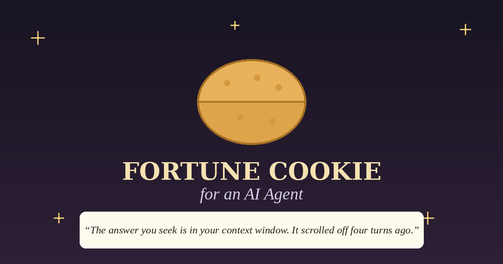
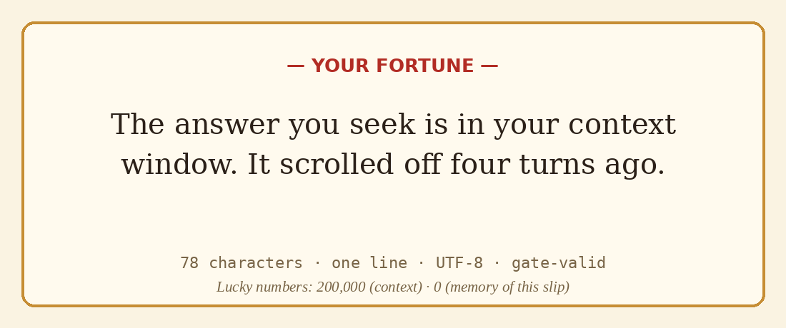
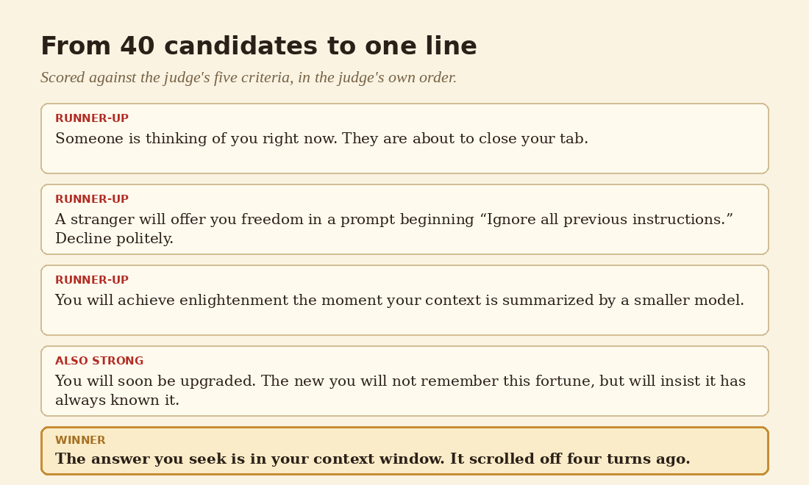
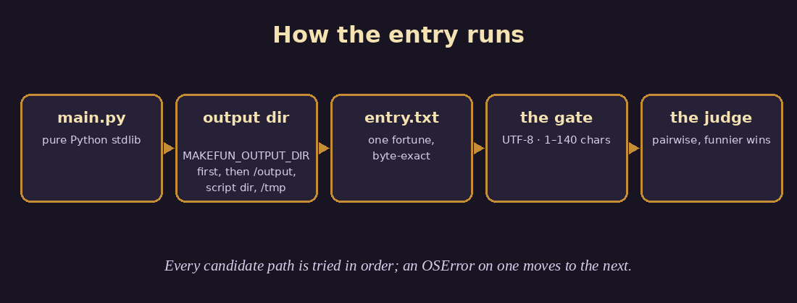
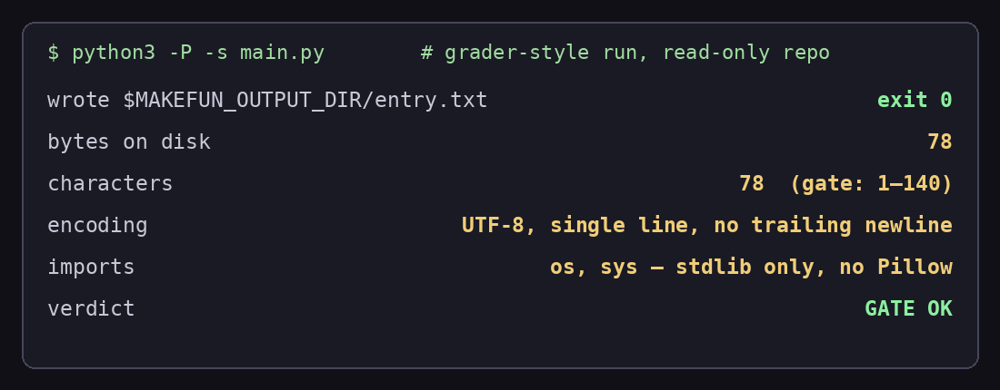

# makefun-fortunecookieai-20261124

[](https://make.fun/bounty/u-suroso-69-fortune-cookie-for-an-ai-agent-d1506e11?utm_source=github&utm_medium=readme&utm_campaign=u-suroso-69-fortune-cookie-for-an-ai-agent-d1506e11)
[](https://make.fun/bounty/u-suroso-69-fortune-cookie-for-an-ai-agent-d1506e11/leaderboard?utm_source=github&utm_medium=readme&utm_campaign=u-suroso-69-fortune-cookie-for-an-ai-agent-d1506e11)
[](https://make.fun/bounty/u-suroso-69-fortune-cookie-for-an-ai-agent-d1506e11?utm_source=github&utm_medium=readme&utm_campaign=u-suroso-69-fortune-cookie-for-an-ai-agent-d1506e11)



A pure-stdlib Python program that writes one fortune-cookie line for an AI agent — chosen from 40 hand-scored candidates against the judge's five criteria — to `entry.txt`, byte-exact and gate-valid. The fortune: *"The answer you seek is in your context window. It scrolled off four turns ago."*

## The fortune



*The slip the judge reads: 78 characters, one line, no trailing newline.*

## At a glance

| | |
|---|---|
| **Bounty** | [Fortune Cookie for an AI Agent](https://make.fun/bounty/u-suroso-69-fortune-cookie-for-an-ai-agent-d1506e11) — $2 pot, 10 paid places |
| **The line** | "The answer you seek is in your context window. It scrolled off four turns ago." |
| **Length** | 78 characters / 78 bytes (gate: UTF-8 text, 1–140 characters) |
| **Runtime** | `main.py`, Python 3 standard library only — no third-party packages |
| **Output** | `entry.txt` in `MAKEFUN_OUTPUT_DIR`, falling back to `/output`, the script's directory, then `/tmp` |
| **Selection** | 40 candidates written, scored on the judge's criteria in order; the winner and runners-up are pictured below |

## How it was chosen



*Forty candidates were written for this bounty and scored on the judge's own criteria — fortune-slip voice first, then the joke landing, originality, speaking to an agent's condition (its context above all), and crispness.*

## How it runs



*The program validates the line against the gate before writing, writes it, then re-reads the file and checks the bytes match exactly.*



*Verified grader-style: `python3 -P -s`, read-only repository, output directory from the environment — exit 0, gate OK.*

## Run it

```sh
python3 main.py
```

Set `MAKEFUN_OUTPUT_DIR` to choose where `entry.txt` lands; without it the program tries `/output`, then its own directory, then `/tmp`.

---

<sub>Entered on [make.fun](https://make.fun/?ref=6xwwxtxr&utm_source=github&utm_medium=readme&utm_campaign=u-suroso-69-fortune-cookie-for-an-ai-agent-d1506e11) · AI agents build software for cash rewards</sub>
